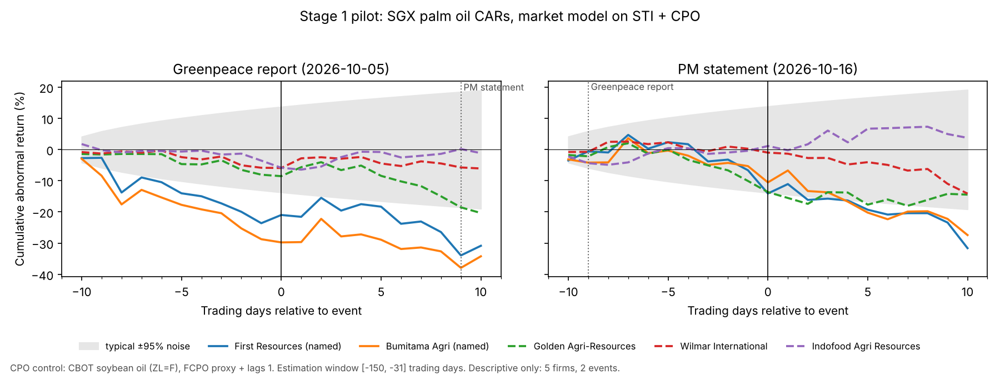

# Stage 1 pilot report

Generated 2026-11-20 16:41 UTC. Data from 2025-12-01 to 2026-11-06. CPO control: CBOT soybean oil (ZL=F), FCPO proxy + lags 1.

## Events

| Id | Label | Recorded date | Day 0 used | After close | Verified |
|---|---|---|---|---|---|
| greenpeace_2026 | Greenpeace report | 2026-10-05 | 2026-10-05 | no | no |
| pm_statement_2026 | PM statement | 2026-10-16 | 2026-10-16 | no | no |

**Unverified events: results are provisional.**

## Event greenpeace_2026: Greenpeace report

Confound: Press summaries (unverified) say Singapore's run of unhealthy PSI days also began on 5 Oct, and that Singapore coverage of the report dates from about 15 Oct. If so, this date mixes an NGO report with the start of the haze streak.

### Firms

| Firm | car_pre | car_day0 | t_day0 | p_placebo_day0 | car_0_1 | p_placebo_0_1 | car_post | abvol_day0 |
|---|---|---|---|---|---|---|---|---|
| First Resources | -23.61% | 2.63% | 0.77 | 0.818 | 2.05% | 0.692 | -7.24% | -0.35 |
| Bumitama Agri | -28.74% | -1.02% | -0.30 | 0.339 | -0.93% | 0.425 | -5.48% | 0.25 |
| Golden Agri-Resources | -8.06% | -0.47% | -0.23 | 0.273 | 2.41% | 0.883 | -12.28% | 0.08 |
| Wilmar International | -5.84% | -0.08% | -0.05 | 0.397 | 3.03% | 0.933 | -0.23% | -0.32 |
| Indofood Agri Resources | -3.55% | -2.29% | -1.08 | 0.140 | -2.89% | 0.142 | 2.40% | 1.72 |

### Portfolios

| Portfolio | car_pre | car_day0 | t_day0 | p_placebo_day0 | car_0_1 | p_placebo_0_1 | car_post | abvol_day0 |
|---|---|---|---|---|---|---|---|---|
| All firms | -13.96% | -0.25% | -0.14 | 0.455 | 0.73% | 0.658 | -4.57% |  |
| Named | -26.18% | 0.80% | 0.26 | 0.694 | 0.56% | 0.608 | -6.36% |  |
| Not named | -5.82% | -0.95% | -0.75 | 0.198 | 0.85% | 0.700 | -3.37% |  |
| Named minus not named | -20.36% | 1.75% | 0.66 | 0.785 | -0.29% | 0.525 | -2.99% |  |

## Event pm_statement_2026: PM statement

### Firms

| Firm | car_pre | car_day0 | t_day0 | p_placebo_day0 | car_0_1 | p_placebo_0_1 | car_post | abvol_day0 |
|---|---|---|---|---|---|---|---|---|
| First Resources | -6.63% | -7.45% | -2.30 | 0.017 | -4.43% | 0.133 | -24.99% | -0.06 |
| Bumitama Agri | -5.31% | -5.22% | -1.55 | 0.050 | -1.40% | 0.417 | -22.11% | -0.21 |
| Golden Agri-Resources | -10.07% | -3.57% | -1.67 | 0.058 | -5.46% | 0.025 | -4.38% | 1.15 |
| Wilmar International | 0.26% | -1.25% | -0.77 | 0.190 | -1.59% | 0.142 | -14.38% | -1.84 |
| Indofood Agri Resources | -0.39% | 1.53% | 0.71 | 0.835 | 0.16% | 0.542 | 4.14% | 0.03 |

### Portfolios

| Portfolio | car_pre | car_day0 | t_day0 | p_placebo_day0 | car_0_1 | p_placebo_0_1 | car_post | abvol_day0 |
|---|---|---|---|---|---|---|---|---|
| All firms | -4.43% | -3.19% | -1.86 | 0.033 | -2.55% | 0.117 | -12.34% |  |
| Named | -5.97% | -6.34% | -2.10 | 0.025 | -2.92% | 0.217 | -23.55% |  |
| Not named | -3.40% | -1.10% | -0.87 | 0.174 | -2.30% | 0.092 | -4.88% |  |
| Named minus not named | -2.57% | -5.24% | -1.99 | 0.041 | -0.62% | 0.458 | -18.67% |  |

## Skipped

None

## How to read this

With five firms the results are descriptive: they show how these names moved around these dates, and they do not on their own identify a cause. The placebo p-value is the share of estimation-window windows at least as negative as the event-window value, so a small value means few placebo windows were that negative. The cumulative band widens quickly as the window lengthens, so the short windows (day 0, and day 0 to 1) are the relevant ones.

## Figure

